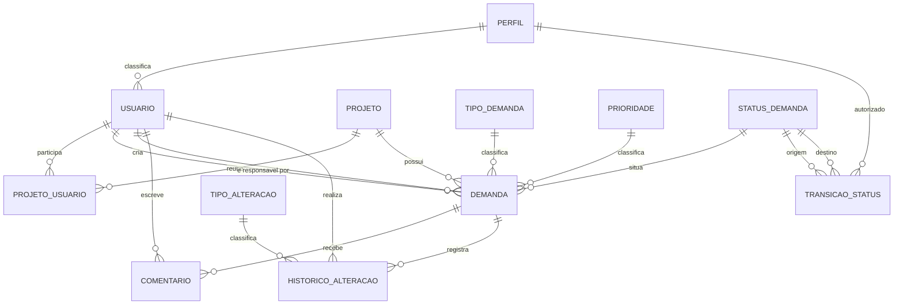

<!-- Autor: Tiago Medeiros - RA: 25000845 -->
<!-- Data: 06/11/2026 -->
<!-- Descrição: Modelagem do banco de dados do Sistema de Acompanhamento de Demandas (PI2) -->

# Modelagem do Banco de Dados

Banco **MySQL 8** (o script também roda no MariaDB 10.5+), nome `pi2_demandas`.
A modelagem parte do escopo do README e dos dados em memória do backend
(`backend/src/data/dados.ts`), para que os nomes e as regras coincidam com o código.

## 1. Diagrama Entidade-Relacionamento (DER)

Imagem: [`der.png`](der.png). O mesmo diagrama em Mermaid (o GitHub renderiza direto):



### Cardinalidades

| Relação | Cardinalidade | Observação |
|---|---|---|
| Perfil → Usuário | 1:N | Todo usuário tem exatamente um perfil |
| Projeto ↔ Usuário | N:N (tabela `projeto_usuario`) | `lider = 1` marca quem gerencia o projeto |
| Projeto → Demanda | 1:N | Toda demanda pertence a um projeto |
| Usuário → Demanda (responsável) | 1:N, opcional | A demanda pode estar sem responsável |
| Usuário → Demanda (criador) | 1:N | Quem cadastrou a demanda |
| Tipo / Prioridade / Status → Demanda | 1:N | Valores fixos do escopo |
| Demanda → Comentário | 1:N | Cada comentário tem autor, data e horário |
| Demanda → Histórico de alterações | 1:N | Registro automático de mudanças relevantes |
| Status × Status × Perfil → Transição | N:N:N | Quais mudanças de status cada perfil pode fazer |

## 2. Dicionário de dados

Legenda: **PK** chave primária · **FK** chave estrangeira · **UK** valor único · **NN** obrigatório.

### perfil
Perfis de acesso do sistema.

| Campo | Tipo | Chave | Nulo | Descrição |
|---|---|---|---|---|
| id | TINYINT UNSIGNED, auto incremento | PK | NN | Identificador do perfil |
| nome | VARCHAR(30) | UK | NN | Administrador, Líder de Projeto ou Membro da Equipe |

### usuario

| Campo | Tipo | Chave | Nulo | Descrição |
|---|---|---|---|---|
| id | INT UNSIGNED, auto incremento | PK | NN | Identificador do usuário |
| nome | VARCHAR(120) | | NN | Nome completo |
| email | VARCHAR(150) | UK | NN | E-mail usado no login |
| senha_hash | VARCHAR(255) | | NN | Hash da senha (bcrypt), nunca a senha em texto |
| perfil_id | TINYINT UNSIGNED | FK → perfil | NN | Perfil de acesso |
| ativo | TINYINT(1) | | NN | 1 = pode acessar; 0 = desativado (padrão 1) |
| criado_em | DATETIME | | NN | Data de cadastro (padrão: agora) |

### projeto

| Campo | Tipo | Chave | Nulo | Descrição |
|---|---|---|---|---|
| id | INT UNSIGNED, auto incremento | PK | NN | Identificador do projeto |
| nome | VARCHAR(100) | UK | NN | Nome do projeto |
| descricao | VARCHAR(500) | | Nulo | Descrição opcional |
| criado_em | DATETIME | | NN | Data de cadastro |

### projeto_usuario
Vínculo entre usuários e projetos.

| Campo | Tipo | Chave | Nulo | Descrição |
|---|---|---|---|---|
| projeto_id | INT UNSIGNED | PK, FK → projeto | NN | Projeto |
| usuario_id | INT UNSIGNED | PK, FK → usuario | NN | Usuário vinculado |
| lider | TINYINT(1) | | NN | 1 = líder do projeto (equivale a `liderIds` do backend). Regra de aplicação: só quem tem perfil Líder de Projeto pode ser líder |

### tipo_demanda

| Campo | Tipo | Chave | Nulo | Descrição |
|---|---|---|---|---|
| id | TINYINT UNSIGNED, auto incremento | PK | NN | Identificador |
| nome | VARCHAR(30) | UK | NN | Tarefa, Defeito, Melhoria ou Documentação |

### prioridade

| Campo | Tipo | Chave | Nulo | Descrição |
|---|---|---|---|---|
| id | TINYINT UNSIGNED, auto incremento | PK | NN | Identificador |
| nome | VARCHAR(30) | UK | NN | Crítica, Alta, Média ou Baixa |
| ordem | TINYINT UNSIGNED | UK | NN | 1 a 4 (1 = mais urgente); usada para ordenar por prioridade |

### status_demanda

| Campo | Tipo | Chave | Nulo | Descrição |
|---|---|---|---|---|
| id | TINYINT UNSIGNED, auto incremento | PK | NN | Identificador |
| nome | VARCHAR(30) | UK | NN | Aberta, Em andamento, Em revisão, Concluída ou Cancelada |
| descricao | VARCHAR(100) | | NN | Significado do status |

### transicao_status
Máquina de estados: cada linha é uma mudança de status permitida para um perfil.

| Campo | Tipo | Chave | Nulo | Descrição |
|---|---|---|---|---|
| status_origem_id | TINYINT UNSIGNED | PK, FK → status_demanda | NN | Status atual |
| status_destino_id | TINYINT UNSIGNED | PK, FK → status_demanda | NN | Novo status |
| perfil_id | TINYINT UNSIGNED | PK, FK → perfil | NN | Perfil autorizado a fazer a mudança |

Restrição: origem e destino devem ser diferentes.

### demanda

| Campo | Tipo | Chave | Nulo | Descrição |
|---|---|---|---|---|
| id | INT UNSIGNED, auto incremento | PK | NN | Identificador |
| titulo | VARCHAR(120) | | NN | Título (mínimo de 5 caracteres, igual à validação do formulário) |
| descricao | TEXT | | NN | Descrição detalhada |
| tipo_id | TINYINT UNSIGNED | FK → tipo_demanda | NN | Tipo da demanda |
| prioridade_id | TINYINT UNSIGNED | FK → prioridade | NN | Prioridade |
| status_id | TINYINT UNSIGNED | FK → status_demanda | NN | Status atual |
| projeto_id | INT UNSIGNED | FK → projeto | NN | Projeto da demanda |
| responsavel_id | INT UNSIGNED | FK → usuario | Nulo | Responsável; vazio enquanto não atribuído |
| criador_id | INT UNSIGNED | FK → usuario | NN | Quem cadastrou |
| criada_em | DATETIME | | NN | Data de criação (padrão: agora) |
| atualizada_em | DATETIME | | NN | Atualizada automaticamente a cada alteração |
| prazo_finalizacao | DATE | | Nulo | Prazo opcional; a API valida contra feriados nacionais |

Índices: projeto, responsável, status, prioridade, tipo e prazo (filtros e ordenação da
listagem e do dashboard) e **FULLTEXT** em título + descrição (busca textual).

### comentario

| Campo | Tipo | Chave | Nulo | Descrição |
|---|---|---|---|---|
| id | INT UNSIGNED, auto incremento | PK | NN | Identificador |
| demanda_id | INT UNSIGNED | FK → demanda | NN | Demanda comentada |
| usuario_id | INT UNSIGNED | FK → usuario | NN | Autor do comentário |
| texto | TEXT | | NN | Conteúdo |
| criado_em | DATETIME | | NN | Data e horário (padrão: agora) |

### tipo_alteracao

| Campo | Tipo | Chave | Nulo | Descrição |
|---|---|---|---|---|
| id | TINYINT UNSIGNED, auto incremento | PK | NN | Identificador |
| nome | VARCHAR(30) | UK | NN | Status, Responsável, Prioridade, Prazo ou Cancelamento |

### historico_alteracao

| Campo | Tipo | Chave | Nulo | Descrição |
|---|---|---|---|---|
| id | BIGINT UNSIGNED, auto incremento | PK | NN | Identificador |
| demanda_id | INT UNSIGNED | FK → demanda | NN | Demanda alterada |
| usuario_id | INT UNSIGNED | FK → usuario | NN | Quem fez a alteração |
| tipo_alteracao_id | TINYINT UNSIGNED | FK → tipo_alteracao | NN | O que foi alterado |
| valor_anterior | VARCHAR(255) | | Nulo | Valor antes (vazio na primeira atribuição) |
| valor_novo | VARCHAR(255) | | Nulo | Valor depois |
| alterado_em | DATETIME | | NN | Data e horário (padrão: agora) |

## 3. Regras de negócio no banco

| Regra do escopo | Como o banco garante |
|---|---|
| Tipo, prioridade e status só aceitam os valores previstos | Tabelas de domínio com chave estrangeira |
| Ciclo de vida do status (Aberta → Em andamento → Em revisão → Concluída; Em revisão → Em andamento; qualquer status exceto Concluída → Cancelada) | Tabela `transicao_status` |
| Membro da Equipe só faz Aberta → Em andamento e Em andamento → Em revisão | Linhas de `transicao_status` por perfil (Administrador e Líder: 7 transições; Membro: 2) |
| Não existe exclusão física de demandas | Trigger `trg_demanda_bloqueia_exclusao` (cancelar = mudar o status) |
| O histórico nunca é apagado nem alterado | Triggers `trg_historico_bloqueia_alteracao` e `trg_historico_bloqueia_exclusao` |
| Comentário tem autor, data e horário | Colunas `usuario_id` e `criado_em` obrigatórias |
| Título com no mínimo 5 caracteres | `CHECK` em `demanda.titulo` |

## 4. Decisões de modelagem

- **Tabelas de domínio no lugar de ENUM.** O README prevê MySQL ou Oracle, e o Oracle não tem ENUM. Tabelas com FK funcionam nos dois e permitem guardar dados extras (como `prioridade.ordem`).
- **Histórico guarda texto, não ids.** `valor_anterior` e `valor_novo` são uma "foto" do momento, então o histórico continua correto mesmo se um nome mudar depois.
- **`criador_id` em demanda.** Não existe no `dados.ts`, mas é necessário para saber quem cadastrou a demanda; o backend deve preenchê-lo com o usuário logado.
- **Regras que ficam na aplicação:** quem pode ser líder de um projeto (só perfil Líder de Projeto), a validação do prazo contra a API de feriados e o preenchimento do histórico a cada alteração.
- **Senha:** o `dados.ts` guarda a senha em texto puro por ser dado de teste. No banco, a coluna é `senha_hash`; o backend deve gerar o hash (bcrypt) no cadastro e usar `compare` no login.

## 5. Como executar

```bash
mysql -u root -p < database/01_schema.sql           # cria o banco, as tabelas e os dados de domínio
mysql -u root -p < database/02_dados_exemplo.sql    # usuários, projetos e demandas de teste (senha 123456)
mysql -u root -p < database/03_consultas_exemplo.sql  # consultas da listagem, do detalhe e do dashboard
```

O `01_schema.sql` recria o banco do zero (`DROP DATABASE IF EXISTS`); use apenas em ambiente de desenvolvimento.
